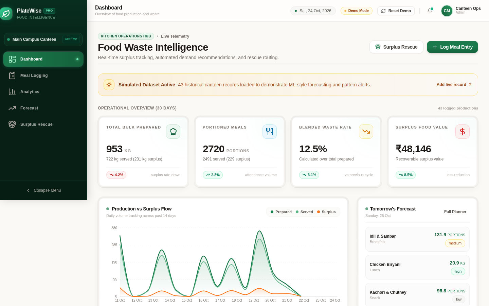
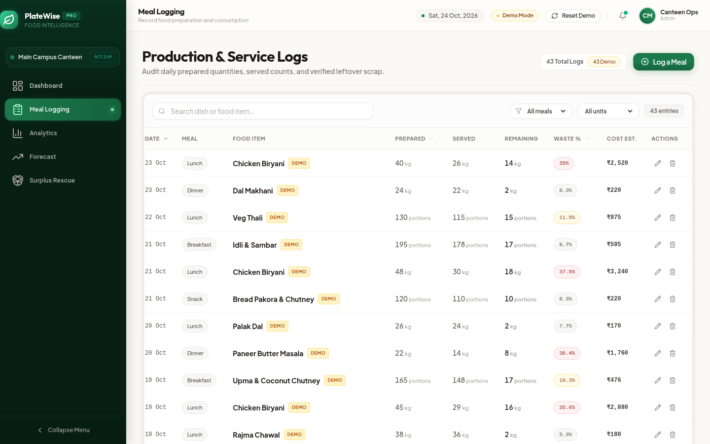
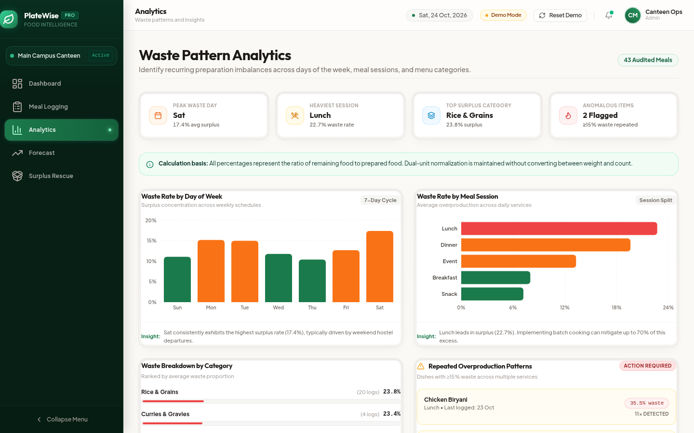
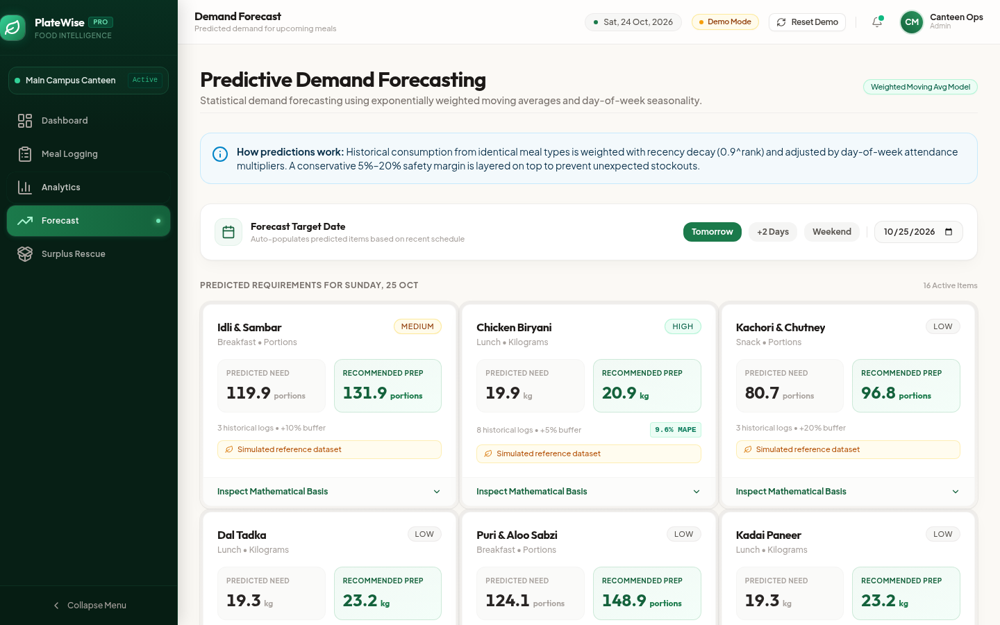
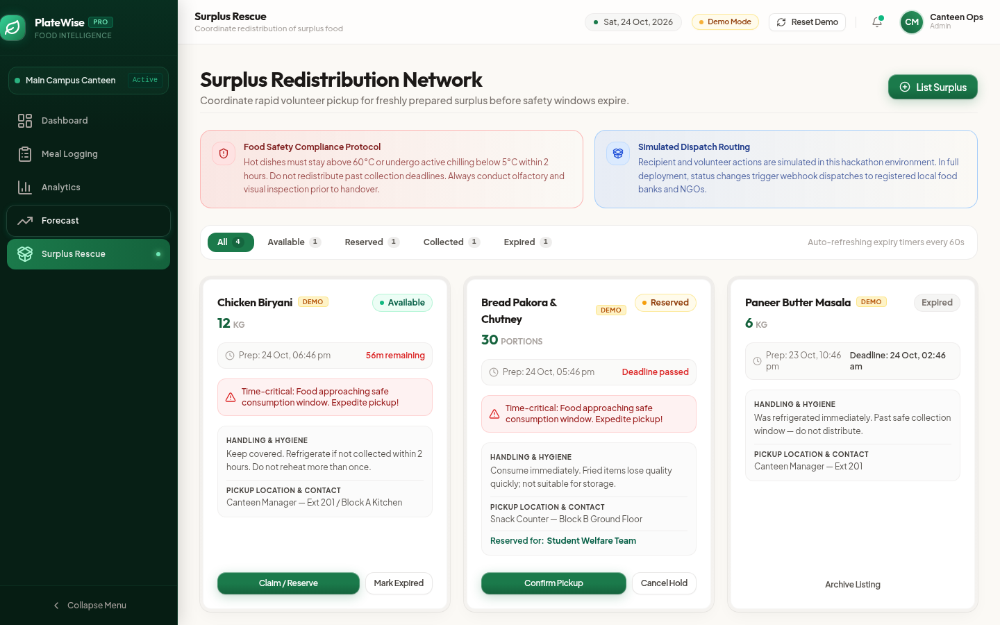

# 🥗 PlateWise — Food Waste Intelligence Platform

<p align="center">
  
</p>

<p align="center">
  <a href="https://platewise-bice.vercel.app"></a>
  <a href="https://platewise-bice.vercel.app/presentation.html"></a>
  
  
  
</p>

---

## 📌 Executive Summary

Institutional kitchens—including university hostels, campus canteens, and corporate caterers—routinely overprepare food by **30% to 45%** because head chefs rely on intuition rather than empirical demand telemetry. In a single mid-sized canteen, this translates to over **₹48,000 lost every 30 days** in discarded ingredients.

**PlateWise** is a full-stack food waste intelligence and forecasting platform designed to solve the three core breakdowns of institutional catering:
1. **Zero-Pollution Dual-Unit Auditing:** Cleanly segregates bulk food measured by weight (**kilograms**) from discrete count items (**portions**) without mathematical mixing.
2. **Deterministic ML Demand Forecasting:** Predicts upcoming session requirements using recency decay ($0.9^{\text{rank}}$) combined with day-of-week seasonality factors—all running with **zero paid external API dependencies**.
3. **Surplus Redistribution Network:** A rapid-action dispatch board featuring real-time food safety countdowns (FSSAI/HACCP 2-hour chill compliance) to connect usable surplus with student welfare teams and local food banks.

---

## 🌐 Live Deployments & Demos

| Resource | URL |
| :--- | :--- |
| **Production Web App** | [https://platewise-bice.vercel.app](https://platewise-bice.vercel.app) |
| **Interactive Slide Deck** | [https://platewise-bice.vercel.app/presentation.html](https://platewise-bice.vercel.app/presentation.html) |
| **Vercel Project Dashboard** | [https://vercel.com/baseplayer23893s-projects/platewise](https://vercel.com/baseplayer23893s-projects/platewise) |

---

## 📸 Product Walkthrough

### 1. Operations Hub & Real-Time Telemetry
Provides immediate visibility into 30-day production volumes, blended scrap percentages, and financial cost impact in INR, alongside a 14-day production-versus-surplus area flow chart.


### 2. Dual-Unit Meal Logging with Invariant Validation
Enforces mathematical consistency (`Quantity Served + Quantity Remaining = Quantity Prepared`). Features real-time scrap percentage previews and strict unit isolation.


### 3. Waste Pattern Analytics & Anomaly Detection
Identifies recurring overproduction patterns across 7-day cycles and session types, automatically detecting dishes with persistent $\ge 15\%$ waste (e.g., *Chicken Biryani at Lunch flagged 11×*).


### 4. Predictive Demand Forecasting Engine
Combines exponential recency weighting with day-of-week multipliers and dynamic safety buffers (5%–20%). Provides transparent glassbox mathematical reasoning and historical MAPE accuracy verification.


### 5. Surplus Rescue & Redistribution Network
Enables kitchen staff to broadcast edible surplus before safety deadlines expire. Manages reservation and collection lifecycles with built-in time-critical temperature and hygiene reminders.


---

## 🔬 Mathematical Forecasting Engine

The forecasting engine in `src/lib/forecasting.ts` operates deterministically with zero cloud LLM latency or API costs:

$$\text{Weight}_i = 0.9^{\text{rank}_i}$$

$$\text{Base Demand} = \frac{\sum (C_i \times \text{Weight}_i)}{\sum \text{Weight}_i}$$

$$\text{Forecasted Need} = \text{Base Demand} \times \text{Seasonality Multiplier}_{\text{Day}} \times (1 + \text{Attendance Delta} \times 0.40)$$

$$\text{Recommended Prep} = \text{Forecasted Need} \times (1 + \text{Safety Buffer})$$

- **Historical Accuracy Verification:** Leave-One-Out Mean Absolute Percentage Error (MAPE) is calculated whenever $\ge 5$ records exist for a recipe.
- **Glassbox Reasoning:** Every prediction exposes the exact historical logs, weights, and multipliers applied.

---

## 🎨 Design Engineering & Craft

Built according to modern high-craft design engineering principles:
- **Doppelrand Hardware Architecture:** All cards and containers feature nested concentric radii (`rounded-2xl` wrapping `rounded-[calc(1rem-0.25rem)]`) with hairline top highlights (`shadow-[inset_0_1px_1px_rgba(255,255,255,0.9)]`).
- **Tactile Micro-Interactions:** Haptic button response (`active:scale-[0.97]` over `160ms ease-[cubic-bezier(0.23,1,0.32,1)]`).
- **Typography:** Paired **Plus Jakarta Sans** (body clarity) with **Outfit** (display authority) and tabular monospace figures for financial and quantity figures.
- **Color Palette:** Warm cream canvas (`#FBF9F5`), obsidian-forest navigation shell (`#071F15`), and vibrant emerald accents (`#15803D`, `#22C55E`).

---

## 🛠️ Tech Stack & Directory Structure

- **Framework:** React 18 + TypeScript 5 + Vite 6
- **Styling:** Tailwind CSS 3 (custom tokens)
- **Data Visualizations:** Recharts 2 (pure SVG area and bar charts)
- **Icons:** Lucide React
- **Unit Testing:** Vitest (43 automated tests)
- **Deployment:** Vercel Edge Network

```
platewise/
├── public/
│   ├── slides/             # High-resolution UI captures
│   └── presentation.html   # Standalone interactive pitch deck
├── src/
│   ├── components/
│   │   ├── dashboard/      # StatCard, WasteTrendChart, RecommendationCard
│   │   ├── layout/         # Sidebar, TopBar, App Layout
│   │   ├── meals/          # MealLogForm, MealLogTable
│   │   ├── surplus/        # SurplusForm, SurplusCard
│   │   └── ui/             # Button, Badge, Input, Select, Modal
│   ├── lib/
│   │   ├── analytics.ts    # Pure analytics functions (stats, trends, alerts)
│   │   ├── forecasting.ts  # Pure forecasting algorithms (WMA, seasonality, MAPE)
│   │   ├── storage.ts      # LocalStorage abstraction layer
│   │   └── constants.ts    # Constants, defaults & palette tokens
│   ├── data/
│   │   └── seedData.ts     # 43 realistic canteen production logs + surplus listings
│   └── __tests__/
│       ├── analytics.test.ts    # 25 test suites
│       └── forecasting.test.ts  # 18 test suites
```

---

## 🚀 Getting Started Locally

### Prerequisites
- Node.js $\ge 18$
- npm $\ge 9$

### Installation
```bash
# Clone the repository
git clone https://github.com/ansonboby/platewise.git
cd platewise

# Install dependencies
npm install

# Start local dev server
npm run dev
```

### Run Test Suite
```bash
# Execute 43 Vitest suites
npm test
```

### Production Build
```bash
# Build optimized assets
npm run build

# Preview production build locally
npm run preview -- --port 4173
```

---

## 📄 License

This project is licensed under the [MIT License](LICENSE).
